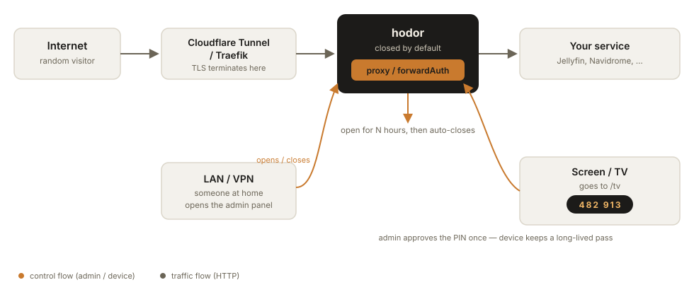
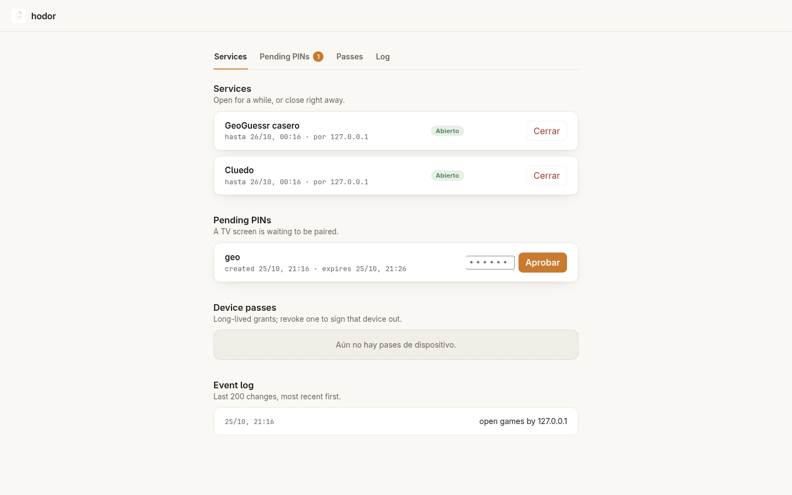
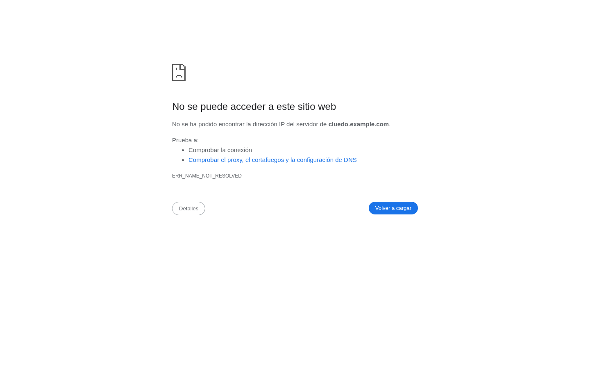

<div align="center">

<picture>
  <source media="(prefers-color-scheme: dark)" srcset="docs/assets/logo-dark.svg">
  
</picture>

# hodor

**Hold the door.**

Self-hosted gatekeeper that keeps your homelab closed to the internet — until someone on the LAN opens it.

[](https://github.com/saezro/hodor/actions/workflows/ci.yml)
[](https://github.com/saezro/hodor/releases)
[](https://goreportcard.com/report/github.com/saezro/hodor)
[](LICENSE)
[](https://github.com/saezro/hodor/pkgs/container/hodor)

</div>

---

## Why

Homelabs leak. A GeoGuessr clone, a Cluedo night, a family photo gallery — the moment it's reachable from the internet, it's reachable by everyone, all the time, whether anyone's actually using it or not.

hodor sits in front of those services and keeps them **closed by default**. Someone on the LAN or VPN opens a service for a few hours when it's actually needed; it closes itself when the timer runs out. No separate auth system, no account to manage per service, no exposure when nobody's playing.

## Features

- 🚪 **Closed by default** — every published service starts shut; opening it is a deliberate action, not a config you forget.
- ⏱️ **Time-boxed access** — open for 1h / 3h / 6h / 24h (configurable presets), auto-closes on its own.
- 🔁 **Proxy or forwardAuth** — run hodor as the reverse proxy itself, or bolt it onto Traefik, Caddy or nginx as an auth check.
- 📺 **TV-friendly pairing** — a screen with no keyboard goes to `/tv`, shows a PIN, and gets a long-lived pass once someone approves it from the panel.
- 🧩 **Groups** — several services behind one switch ("games" opens GeoGuessr *and* Cluedo together).
- 🔒 **Admin panel stays on the LAN** — CIDR-restricted, never exposed through the tunnel.
- 🪶 **Single static binary** — Go, no CGO, practically no dependencies, one `hodor.yaml`.

## How it works

<picture>
  <source media="(prefers-color-scheme: dark)" srcset="docs/assets/how-it-works.svg">
  
</picture>

1. Internet traffic hits your tunnel/proxy, which forwards to hodor.
2. hodor checks whether the service is open. Closed → closed page (or `401`/redirect for forwardAuth). Open → request goes through.
3. Someone on the LAN/VPN opens the admin panel and flips the switch for N hours.
4. A TV or other keyboard-less screen goes to `/tv`, shows a PIN, gets approved once, and keeps a long-lived pass from then on — the service being closed doesn't lock it out.

## Quick start

```yaml
# docker-compose.yml
services:
  hodor:
    image: ghcr.io/saezro/hodor:latest
    restart: unless-stopped
    ports: ["8081:8081"]          # admin — keep this off the tunnel
    volumes:
      - ./hodor.yaml:/etc/hodor.yaml:ro
      - hodor-data:/data
  cloudflared:
    image: cloudflare/cloudflared:latest
    command: tunnel run
    environment: { TUNNEL_TOKEN: ${TUNNEL_TOKEN} }
volumes: { hodor-data: }
```

Point your Cloudflare Tunnel (or Traefik/Caddy/nginx) at `hodor:8080`, keep `8081` on the LAN only, and you're closed by default.

### Example `hodor.yaml`

```yaml
lang: en
secret_file: /run/secrets/hodor      # generated on first run if missing
state_file: /data/state.json
listen: { public: ":8080", admin: ":8081" }
admin:
  allow_cidrs: [192.168.0.0/16, 10.0.0.0/8, 172.16.0.0/12, 100.64.0.0/10, 127.0.0.0/8]
  public_url: https://games.home.example.com
durations: [1h, 3h, 6h, 24h]
services:
  - name: geo
    title: Homemade GeoGuessr
    hosts: [geo.example.com]
    mode: proxy
    upstream: http://geo:3469
    group: games
    pass_bypasses_closed: true
  - name: cluedo
    hosts: [cluedo.example.com]
    mode: proxy
    upstream: http://cluedo:3465
    group: games
```

Validate it anytime with `hodor check -c hodor.yaml`.

## forwardAuth mode

Don't want hodor proxying traffic itself? Point your existing reverse proxy at `GET /auth` on hodor's public listener instead — `200` means pass, a closed service redirects (or `401`s, for nginx) to hodor's own closed page.

**Traefik**

```yaml
labels:
  - traefik.http.middlewares.hodor.forwardauth.address=http://hodor:8080/auth
  - traefik.http.routers.geo.middlewares=hodor
```

**Caddy**

```caddyfile
geo.example.com {
    forward_auth hodor:8080 {
        uri /auth
    }
    reverse_proxy geo:3469
}
```

**nginx**

```nginx
location / {
    auth_request /hodor-auth;
    error_page 401 = @hodor_closed;
    proxy_pass http://geo:3469;
}
location = /hodor-auth {
    internal;
    proxy_pass http://hodor:8080/auth;
}
```

Either way, route `/.hodor/*` through to hodor so the closed page and `/tv` pairing flow are reachable on the real hostname.

## The TV flow

A living-room screen has no keyboard and no browser extensions — so it doesn't log in, it *pairs*:

1. Open `https://<host>/tv` on the screen. It shows a 6-digit PIN (QR code coming in a later release).
2. From the admin panel (or by typing the PIN there), someone approves it.
3. The TV gets a signed, long-lived cookie (`hodor_pass_<service>`, default 30-day TTL) and from then on gets in even while the service is closed to everyone else — that's the whole point of a device pass.
4. Passes are listed per service in the panel and can be revoked individually at any time.

## How it compares

hodor is deliberately narrow: it's a *time-boxed, physically-gated switch*, not a full auth platform.

| | hodor | [Sablier](https://github.com/sablierapp/sablier) | [tinyauth](https://github.com/steveiliop56/tinyauth) | Cloudflare Access | Tailscale Funnel |
|---|---|---|---|---|---|
| Closed-by-default, opened by someone on the LAN | ✅ | ❌ (scales containers on demand, not access-gated) | ❌ (always-on auth) | ❌ (always-on policy) | ❌ (always reachable while funneled) |
| Auto-closes after N hours | ✅ | ➖ (idle-based, not a timer) | ❌ | ➖ (session-based) | ❌ |
| Keyboard-less device pairing (TV, console) | ✅ | ❌ | ❌ | ➖ (service tokens, not PIN pairing) | ❌ |
| Per-user login / SSO | ❌ | ❌ | ✅ | ✅ | ✅ (via Tailscale identity) |
| Scales containers to zero | ❌ | ✅ | ❌ | ❌ | ❌ |
| Needs an external account/service | ❌ | ❌ | ❌ | ✅ (Cloudflare) | ✅ (Tailscale) |
| forwardAuth for Traefik/Caddy/nginx | ✅ | ✅ | ✅ | ➖ (own edge only) | ❌ |

If you need per-user identity and audit logs, pair hodor with Cloudflare Access or Tailscale rather than replacing them — hodor solves "is this even open right now", not "who are you".

## Screenshots

<!-- TODO: capture once the admin panel UI lands — see internal/web -->
<!--  -->
<!--  -->

## Security

- Constant-time comparisons for secrets and PINs, HMAC-signed passes, CSRF tokens on every panel POST.
- Admin listener is CIDR-restricted by default (RFC1918 + CGNAT + loopback) and never meant to sit behind the public tunnel.
- Rate limiting on PIN attempts (10 min expiry, 5 attempts), no secrets in logs, security headers on every hodor-served page.
- Found an issue? See [SECURITY.md](SECURITY.md) for how to report it privately.

## Roadmap

- [ ] QR code on `/tv` (currently PIN-only)
- [ ] Prometheus histograms for request latency
- [ ] Multi-admin accounts with per-user audit trail
- [ ] Optional email/push digest of what's currently open

## Contributing

Issues and PRs welcome — see [CONTRIBUTING.md](CONTRIBUTING.md) for the dev setup (`go test ./...`, `golangci-lint run`) and the table-test conventions used across the codebase.

## License

[MIT](LICENSE) — © 2026 saezro

---

<sub>Named after a certain doorkeeper who held the door. Not affiliated with HBO.</sub>
